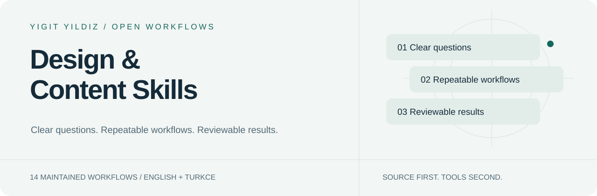

<picture>
  <source media="(prefers-color-scheme: dark)" srcset="assets/hero-dark.svg">
  
</picture>

# Design & Content Skills

[English](README.md) · [Türkçe](README.tr.md)

**Arayüz, görsel sistem, yazı, sunum ve görsel/video üretim iş akışları.**

14 bakımı sürdürülen giriş noktası. Göreve göre birini seç; tüm kütüphaneyi bağlama yükleme.

[Başla](docs/INSTALL.md) · [Katalog](https://yigityildiz0.github.io/universal-ai-skill-library/) · [İndirmeler](DOWNLOADS.md) · [Bakım modeli](MAINTAINING.md)

## Yapmak istediğin işi seç

<strong>Öğrenme ve yazı</strong> · 2

| Skill | Ne işe yarar? |
|---|---|
| [office-docs-qa](docs/skills/office-docs-qa.tr.md) | Belge yapısı, içerik ve görünümü açık doğrulama sınırlarıyla kontrol eder. |
| [yigit-writer](docs/skills/yigit-writer.tr.md) | Olgusal anlamı değiştirmeden açık mesaj, yazı ve akademik metin üretir/düzenler. |

<strong>Tasarım ve üretim</strong> · 12

| Skill | Ne işe yarar? |
|---|---|
| [ai-image-video-studio](docs/skills/ai-image-video-studio.tr.md) | Yerel ComfyUI dahil görsel/video üretimini planlar ve sorun giderir. |
| [banner-design](docs/skills/banner-design.tr.md) | Gerçek platform ölçüsü, okunabilir mesaj ve belirgin eylem etrafında banner tasarlar. |
| [brand](docs/skills/brand.tr.md) | Görsel kimlik, üslup ve mesajı farklı çıktılarda tutarlı tutar. |
| [campaign-plan](docs/skills/campaign-plan.tr.md) | Kitle, kanal, içerik, kaynak ve ölçülebilir sonuçlarla kampanya planlar. |
| [design](docs/skills/design.tr.md) | Tasarım işini uygun marka, arayüz, ikon, banner veya sunum akışına yönlendirir. |
| [design-system](docs/skills/design-system.tr.md) | Tasarım tokenları, bileşen özellikleri ve hedef kitleye uygun sunumları bağlar. |
| [site-seo-audit](docs/skills/site-seo-audit.tr.md) | Öneriler uygulanmış gibi göstermeden gözlenebilir teknik/içerik SEO denetimi yapar. |
| [slides](docs/skills/slides.tr.md) | HTML, PDF ve düzenlenebilir slayt ayrımını koruyarak anlaşılır sunum yapılandırır. |
| [ui-styling](docs/skills/ui-styling.tr.md) | Projenin mevcut bileşenlerini ve tokenlarını koruyan arayüz stili uygular. |
| [ui-ux-pro-max](docs/skills/ui-ux-pro-max.tr.md) | Stil, palet, tipografi, grafik ve platform stackleri arasında tasarım bilgisi arar. |
| [web-animation](docs/skills/web-animation.tr.md) | Erişilebilirlik ve mevcut entegrasyonu koruyarak GSAP/Motion örüntüleri uygular. |
| [web-ui-design](docs/skills/web-ui-design.tr.md) | Gerçek görev, hiyerarşi, responsive düzen ve erişilebilirlik etrafında arayüz tasarlar. |

## Bir skill nasıl çalışır?

~~~mermaid
flowchart LR
 A[Your goal] --> B[Match the skill]
 B --> C[Load relevant module]
 C --> D[Use available tools]
 D --> E[Verify and explain]
~~~

Bu bir iş akışıdır; araç çalıştırıldığı veya bütün sonuçların doğrulandığı iddiası değildir. Her skill sayfasında örnek istek, tetikleme, mekanik, girdi/çıktı ve kaynak modüller var.

## Tek kaynak, kalıcı koleksiyonlar

Ana kaynak [Universal AI Skill Library](https://github.com/yigityildiz0/universal-ai-skill-library). Alan depoları aynı sürümün seçilmiş görünümleridir; ayrı ayrı çatallanıp elle düzenlenmez. Mevcut bağlantılar ve geçmiş korunur.

[All collections / Tüm koleksiyonlar](COLLECTIONS.md) · [Legacy/community resources](LEGACY.md) · [Licenses & provenance](docs/LICENSE-SCOPE.md)

## Dürüst kapsam

- Skill kurmak model eğitmek veya hesap/araç bağlamak değildir.
- Yerel dosya ile web hesabına yükleme farklıdır; desteklenen host akışını kullan.
- Ek ücretli API veya model indirme otomatik yapılmaz.
- Eski topluluk kataloğu güncel giriş noktalarının sayısına veya test iddiasına dahil değildir.
- Kaynak lisansları korunur; bütün üçüncü taraf içeriğine tek lisans varsayılmaz.

---
Maintained by [Yigit Yildiz](https://github.com/yigityildiz0) · Source edition 2026.10.11
